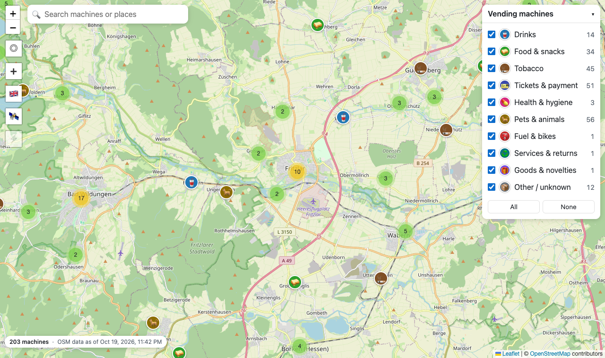
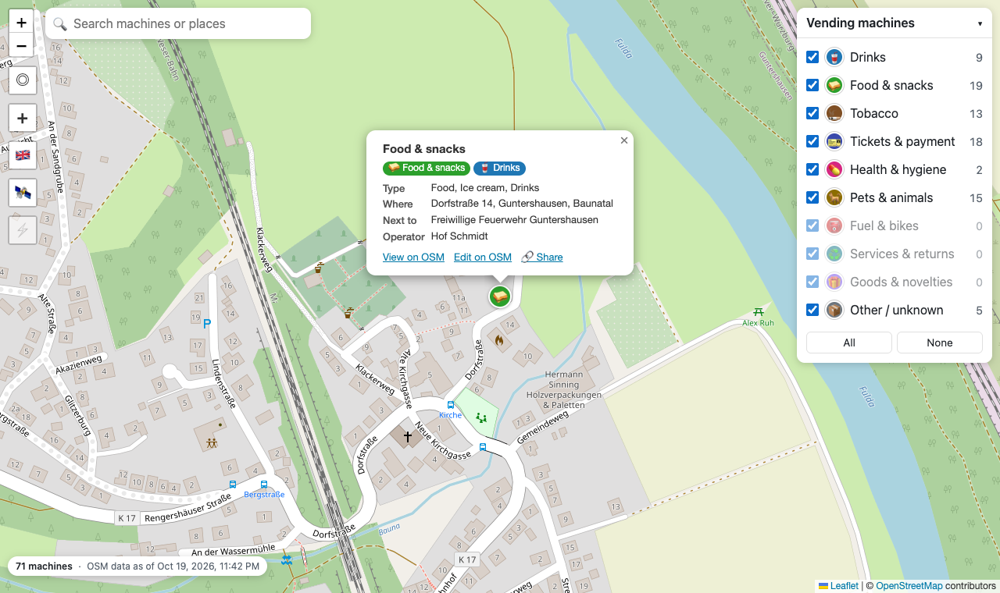
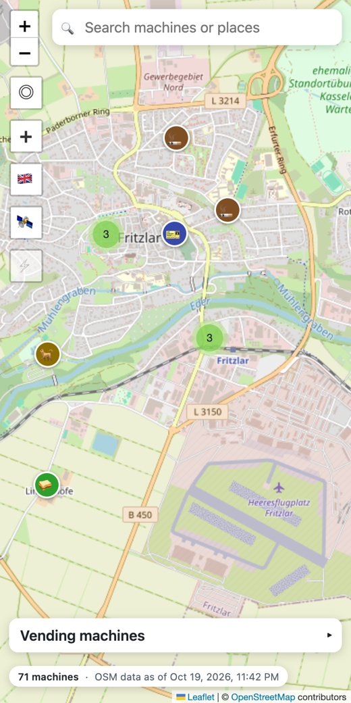

# osm-vending-map

**Find the vending machine you need: drinks, snacks, cigarettes, parking tickets, farm-fresh eggs. And add the ones the map is missing.**

👉 **[kibubu.github.io/osm-vending-map](https://kibubu.github.io/osm-vending-map/)**



## Why

Vending machines are everywhere, but there's no good map of them. In rural areas especially, they matter more than you'd think: the egg and sausage machine at a farm, the 24/7 food box in a village with no shop, the ticket machine at a car park. [OpenStreetMap](https://www.openstreetmap.org/) already has many of them (`amenity=vending_machine`), but general map apps barely show them and say nothing about what they sell.

This site shows only vending machines, sorted by what they sell, and makes it easy to add a missing one to OSM, so the map gets better for everyone. It currently covers **Fritzlar and surroundings** (northern Hesse, Germany). The data pipeline handles all of Europe.

## What it does



- **Filter by what's sold:** drinks, food, tobacco, tickets, pet food and more (9 groups covering every `vending=*` value in use).
- **Details at a glance:** what it sells, where it is (street, village, nearby shop), operator, payment, opening hours.
- **Search** machines by name, product or location, and places via Nominatim.
- **Add missing machines** straight to OSM with your own account, or as an anonymous OSM note.
- **Works outdoors:** offline after the first visit and on a weak mobile signal.
- Satellite view, shareable links, six languages, mobile layout.



<br clear="right">

## How it works

A plain static site (HTML/CSS/JS with [Leaflet](https://leafletjs.com/), no backend, no build step). A nightly GitHub Action queries [Postpass](https://postpass.geofabrik.de/) for all vending machines in the region, adds a short location description to each, cuts the result into small tiles and deploys to GitHub Pages. The map loads only the tiles you look at.

Run it locally:

```bash
npm run tiles -- --postpass 50.93,8.95,51.33,9.60 --region "Fritzlar and surroundings"
```

```bash
npm run serve
```

Then open http://127.0.0.1:8000/.

**More:** features, data tiles, OSM upload setup, changing the region and deployment are documented in [docs/details.md](docs/details.md).

## Licence

Map data © [OpenStreetMap contributors](https://www.openstreetmap.org/copyright), [ODbL](https://opendatacommons.org/licenses/odbl/). Code: MIT. Full attribution in [docs/details.md](docs/details.md#attribution--licences).
